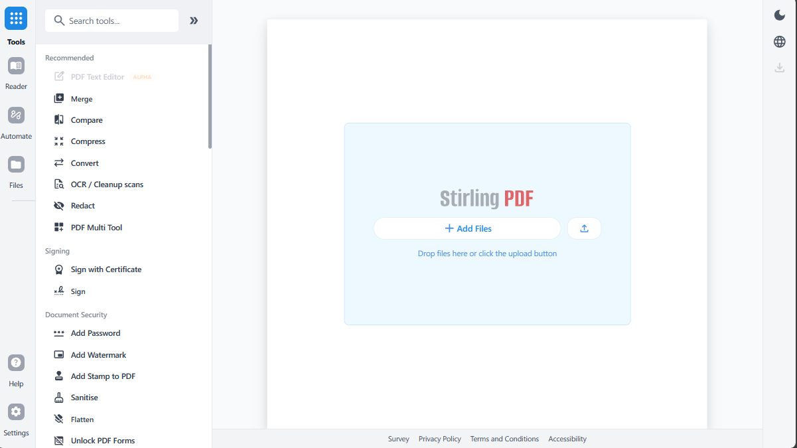

<h1 align="center">CerradoPDF</h1>

<p align="center"><b>Sistema Institucional de Manipulação de Documentos PDF — UniCerrado (Centro Universitário de Goiatuba)</b></p>

O **CerradoPDF** é a distribuição institucional da UniCerrado baseada no projeto open-source
[CerradoPDF](https://github.com/CerradoPDF-Tools/CerradoPDF). Ele disponibiliza à comunidade
acadêmica (alunos, professores, servidores e setores administrativos) uma suíte de ferramentas
de PDF — mesclar, dividir, comprimir, converter, OCR, assinar e proteger documentos — hospedada
na infraestrutura da própria instituição, sem envio de documentos a serviços externos.

## Diferenças institucionais em relação ao CerradoPDF

- **Login institucional obrigatório**: acesso via conta Google Workspace da UniCerrado
  (OAuth2/OIDC), com allowlist de domínios configurável por variável de ambiente
  (`SECURITY_ALLOWEDEMAILDOMAINS`, ex.: `alunos.unicerrado.edu.br`). E-mails externos
  (Gmail, Outlook etc.) são bloqueados.
- **Identidade UniCerrado**: nome, logotipo, cores (azul institucional + verde-lima sobre fundo
  creme) e textos em português adaptados ao padrão visual de unicerrado.edu.br.
- **Pronto para produção**: configuração 100% por variáveis de ambiente, compose próprio
  (`docker/compose/docker-compose.cerradopdf.yml`) e suporte a proxy reverso com HTTPS.

## Instalação (servidor institucional)

Consulte **[INSTALACAO.md](INSTALACAO.md)** para o guia completo: requisitos, autenticação
Google Workspace, domínios permitidos, Docker Compose, proxy reverso e HTTPS.

Resumo:

```bash
cp .env.example .env          # ajuste domínios, segredos e URL pública
docker compose --env-file .env -f docker/compose/docker-compose.cerradopdf.yml up -d --build
```

## Créditos e licença

O CerradoPDF é derivado do **CerradoPDF** (CerradoPDF-Tools). O código-fonte permanece licenciado
nos termos da licença original do projeto — consulte [LICENSE](LICENSE) e os avisos de terceiros
em `app/core/src/main/resources/static/3rdPartyLicenses.json`. Todos os créditos do projeto
original são preservados.

---

*A documentação abaixo é a do projeto original (CerradoPDF), mantida como referência técnica.*

---

<p align="center">
  
</p>

<h1 align="center">CerradoPDF - The Open-Source PDF Platform</h1>

CerradoPDF is a powerful, open-source PDF editing platform. Run it as a personal desktop app, in the browser, or deploy it on your own servers with a private API. Edit, sign, redact, convert, and automate PDFs without sending documents to external services.

<p align="center">
  <a href="https://hub.docker.com/r/stirlingtools/stirling-pdf">
    
  </a>
  <a href="https://discord.gg/HYmhKj45pU">
    
  </a>
  <a href="https://scorecard.dev/viewer/?uri=github.com/CerradoPDF-Tools/CerradoPDF">
    
  </a>
  <a href="https://github.com/CerradoPDF-Tools/stirling-pdf">
    
  </a>
</p>



## Key Capabilities

- **Everywhere you work** - Desktop client, browser UI, and self-hosted server with a private API.
- **50+ PDF tools** - Edit, merge, split, sign, redact, convert, OCR, compress, and more.
- **Automation & workflows** - No-code pipelines direct in UI with APIs to process millions of PDFs.
- **Enterprise‑grade** - SSO, auditing, and flexible on‑prem deployments.
- **Developer platform** - REST APIs available for nearly all tools to integrate into your existing systems.
- **Global UI** - Interface available in 40+ languages.

For a full feature list, see the docs: **https://docs.cerradopdf.com**

## Quick Start

```bash
docker run -p 8080:8080 docker.cerradopdf.com/stirlingtools/stirling-pdf
```

Then open: http://localhost:8080

For full installation options (including desktop and Kubernetes), see our [Documentation Guide](https://docs.cerradopdf.com/#documentation-guide).

## Resources

- [**Documentation**](https://docs.cerradopdf.com)
- [**Homepage**](https://stirling.com)
- [**API Docs**](https://registry.scalar.com/@cerradopdf/apis/stirling-pdf-processing-api/)
- [**Server Plan & Enterprise**](https://docs.cerradopdf.com/Paid-Offerings)

## Support

- **Community**: [Discord](https://discord.gg/HYmhKj45pU)
- **Bug Reports**: [GitHub Issues](https://github.com/CerradoPDF-Tools/CerradoPDF/issues)


## Contributing

We welcome contributions! Please see [CONTRIBUTING.md](CONTRIBUTING.md) for guidelines.

This project uses [Task](https://taskfile.dev/) as a unified command runner for all build, dev, and test commands. Run `task dev` to get started running the editor, run `task` to see the most common commands, or see the [Developer Guide](DeveloperGuide.md) for full details.

For adding translations, see the [Translation Guide](devGuide/HowToAddNewLanguage.md).

## License

CerradoPDF is open-core. See [LICENSE](LICENSE) for details.
